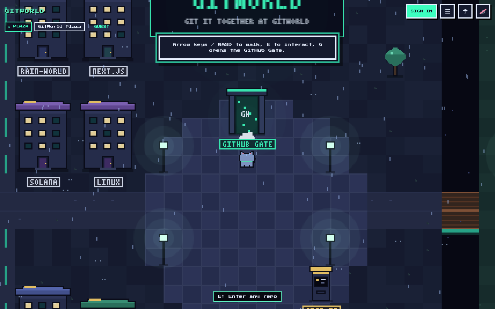
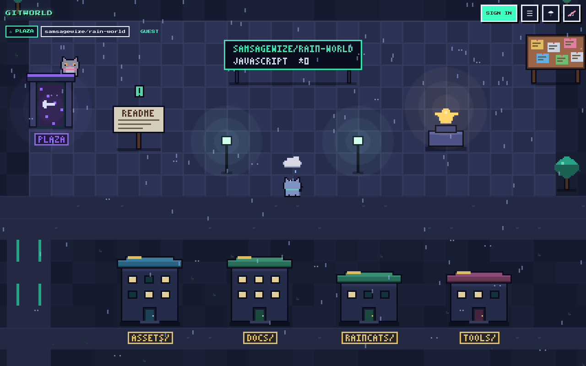
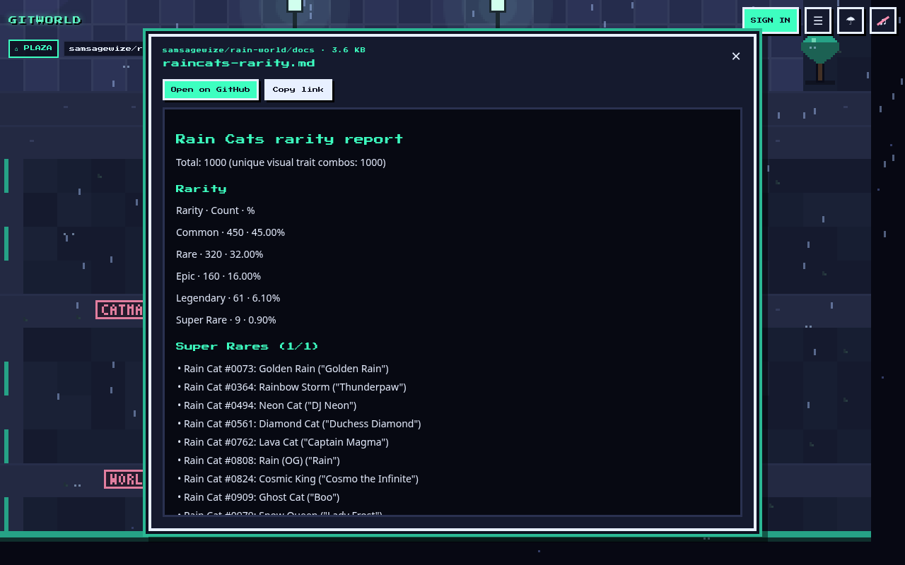
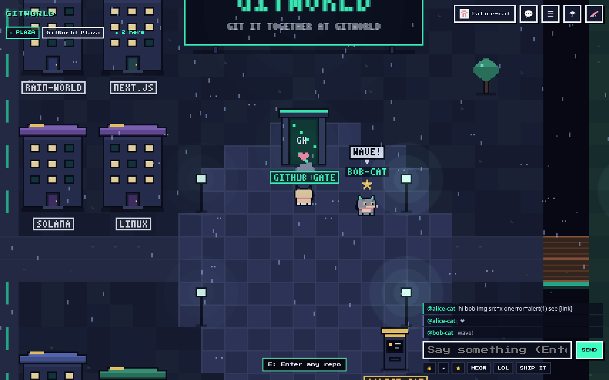
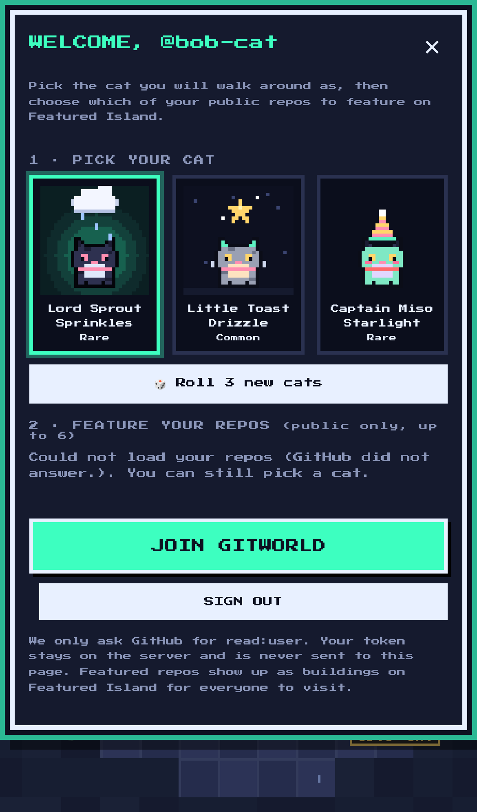

# GitWorld

**Git it together at GitWorld**

**Play:** https://gitworld-gold.vercel.app · try [samsagewize/rain-world](https://gitworld-gold.vercel.app/?repo=samsagewize/rain-world) or [vercel/next.js](https://gitworld-gold.vercel.app/gh/vercel/next.js)

GitWorld turns any public GitHub repo into a pixel town you can walk around as a cat. Folders are buildings, files are things you can open, the README is a sign out front, and other people walk around with you in real time.

It is built from the engine, pixel style, and cat generator of [Rain's World](https://github.com/samsagewize/rain-world).



## What you can do

- **Walk into any public repo.** Use the GitHub Gate in the plaza, or a share link: `/?repo=owner/name` or `/gh/owner/name` (`/gh/owner/name/tree/branch/path` works too). Extra parameters: `&path=src`, `&page=2`, `&file=README.md`.
- **Repo-as-town:**
  - Each folder is a building you can enter.
  - Files are objects (code, docs, images, data, web files, binaries, submodules). Each one opens a viewer with line numbers, safe Markdown or an image preview.
  - The README is a sign. At the repo root you'll find a stars statue, a commits notice board and contributor cats.
  - Folders with more than 60 items are split into numbered streets with next/prev portals.
  - To go back, use the back portal, the breadcrumbs bar, Backspace or the browser's Back button.
- **Multiplayer:** everyone in the same repo folder (the same "room") sees each other's cats live, with names over their heads, chat bubbles and emotes (wave, heart, star, meow, lol, ship it).
- **Sign in with GitHub:**
  - Guests can browse everything read-only. Joining the live world and chat requires signing in.
  - First sign-in: choose one of 3 random cats made with the Rain's World cat generator, then pick up to 6 of your public repos to feature. They become buildings on **Featured Island** for everyone to visit.
- **Desktop and iPhone controls:**
  - Desktop: arrow keys/WASD to walk, E to interact, G opens the Gate, T or / to chat, 1–6 for emotes, Esc closes panels.
  - iPhone: tap to walk, plus a D-pad and an A button.

| Town | File viewer | Multiplayer | Onboarding (iPhone) |
|---|---|---|---|
|  |  |  |  |

## Stack

- Next.js 16 on Vercel. The game is plain canvas JS in `public/` (`engine.js`, `gitworld.js`), and the API lives in `app/api/*`.
- [Auth.js](https://authjs.dev) (next-auth v5) with the GitHub provider and the `read:user` scope only.
- Upstash Redis over REST, with short polling (about 0.7 s when others are around, slower when you're alone or the tab is hidden). It works on serverless with no websocket server.

## Environment variables

| Variable | What it is |
|---|---|
| `AUTH_SECRET` | Random secret that encrypts the session cookie (`openssl rand -base64 33`). |
| `AUTH_GITHUB_ID` | Client ID of a GitHub OAuth App. |
| `AUTH_GITHUB_SECRET` | Client secret of that OAuth App. |
| `KV_REST_API_URL` / `KV_REST_API_TOKEN` | Upstash Redis REST URL and token (set automatically by the Vercel Upstash integration). `UPSTASH_REDIS_REST_URL` / `UPSTASH_REDIS_REST_TOKEN` work too. |

GitHub OAuth App settings (GitHub → Settings → Developer settings → OAuth Apps → New):

- Homepage URL: `https://<your-domain>`
- Authorization callback URL: `https://<your-domain>/api/auth/callback/github`

What works without which variables:

- **None set:** guest browsing works fully, straight from the browser to the public GitHub API, with caching.
- **Auth set, no Redis:** sign-in and choosing a cat work (the cat is kept in an httpOnly cookie). Multiplayer, chat and featured repos stay off.
- **Everything set:** the full live world.

## Security model

- **Tokens never reach the browser.**
  - The GitHub OAuth token stays inside the encrypted Auth.js JWT cookie (httpOnly, Secure, SameSite=Lax). Only route handlers read it.
  - The session the page sees contains just the login and name.
- **Your own token, your own quota.**
  - `/api/gh` is a read-only proxy for signed-in players. It calls GitHub with *that player's* token and never with a site-owner token.
  - It allows only four endpoints (repo, tree, commits, contributors), refuses private repos, trims responses and caches them in Redis for 10 minutes.
  - Guests call GitHub's public API directly.
- **Minimal scope:** `read:user`. Repos to feature are listed from the player's own public repos (`visibility=public`) and checked again on the server before saving.
- **Server-side validation of everything:**
  - Room names, positions (speed check against teleporting), cat codes, featured repos, emotes and chat.
  - Same-origin checks on every POST, and JSON body size caps.
- **Rate limits** (Redis fixed windows, with an in-memory fallback):

  | Action | Limit |
  |---|---|
  | Moves | 150/min |
  | Chat | 1 per 2 s and 20/min, duplicates within 30 s rejected |
  | Proxy | 120/min |
  | Profile saves | 10/min |
  | Repo list | 20/min |
  | Reports | 5 per 10 min |

- **Chat filter:**
  - 120 characters max; control and zero-width characters plus `<` and `>` are stripped.
  - Links become `[link]` and repeated letters are squashed.
  - Profanity is starred out (leetspeak-aware, without flagging innocent words), and shouty caps spam is rejected.
- **No HTML injection:**
  - Every name, chat line and file is rendered with `textContent` or drawn on the canvas.
  - Markdown is parsed into DOM nodes, never `innerHTML`. `javascript:` and `data:` links are refused.
  - A strict CSP (`script-src 'self'`), `X-Frame-Options: DENY` and `nosniff` are set.
- **Moderation:**
  - Every player card has Mute, Block and Report. Mute and block are stored locally.
  - Reports go to the Redis list `reports`, together with the reported player's recent chat. A counter is kept at `reported:<login>`.
  - To ban someone: `SET ban:<login> 1`.
  - Rooms are capped at 30 players.

## Local development

```bash
npm install
cp .env.example .env.local   # fill in what you have; everything is optional for guest mode
npm run dev                  # http://localhost:3000
```

For the local OAuth App, use the callback `http://localhost:3000/api/auth/callback/github`.

## Tests

- `tools/test.js`: Playwright, desktop plus iPhone 13, in guest mode.
  - Covers `samsagewize/rain-world`, `vercel/next.js` and a repo that doesn't exist.
  - Checks entering a folder, opening a file, going back, browser Back/Forward, the README, commits, street pages and bad input.
  - GitHub responses are cached on disk so reruns cost no API quota.
- `tools/mp-test.js`: two signed-in players against a local Redis, using `tools/upstash-shim.js` (an Upstash REST shim for a local `redis-server`) and `tools/mint.mjs` (test sessions signed with a throwaway local `AUTH_SECRET`).
  - Covers onboarding, seeing each other, chat sanitizing, emotes, per-folder rooms, report and block.

```bash
BASE=http://localhost:3000 node tools/test.js
```

## License

MIT
